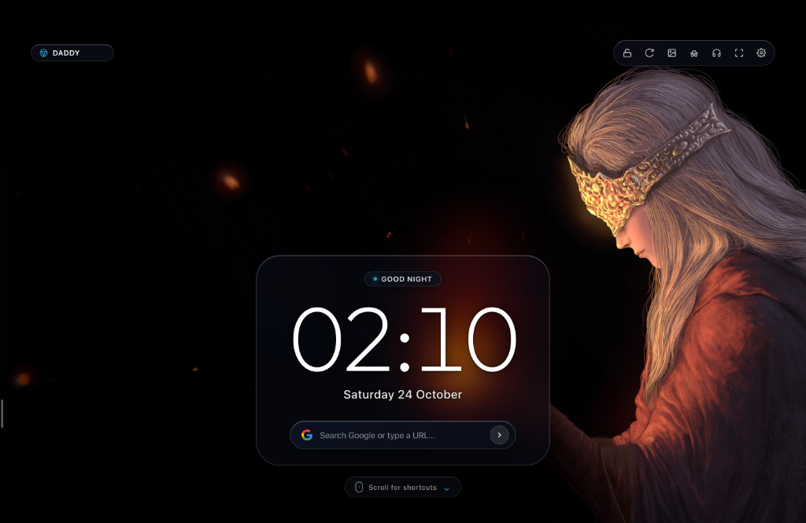
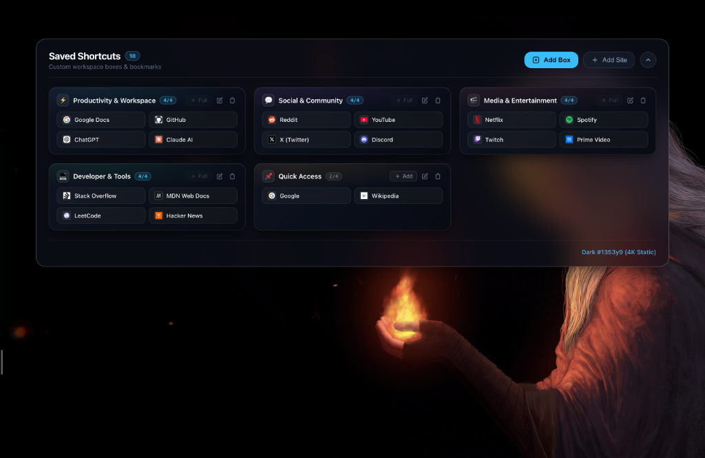

# 🌌 Smartabs - Minimalist New Tab & Live Wallpapers
> **Ultra-minimalist, distraction-free New Tab extension for Google Chrome & Brave Browser.**

Smartabs turns every new browser tab into an immersive, aesthetic sanctuary. When you open a tab, you are greeted by an ultra-clean, minimalist interface with breathtaking 4K wallpapers or animated live motion video backgrounds. When you scroll down, a sleek glassmorphism dashboard glides up revealing your organized workspace boxes, shortcuts, and AI launchpad.

<p align="center">
  
</p>

---

## ✨ Key Features

1. **Ultra-Minimalist Sanctuary (Default View)**:
   - Zero clutter, clean full-bleed ambient aesthetic.
   - Professional macOS-style time display with auto-contrast detection:
     - **Floating Text (Auto Contrast)**: Clean typography inspired by macOS lock screen.
     - **Frosted Glass Pill**: macOS-style pill with 32px backdrop blur.
   - Seamless wallpaper luminance detection that dynamically shifts text between light and dark themes.
   - Built-in minimalist Google Search bar directly below the time.

2. **Categorized Liquid Workspace Boxes**:
   - **4-Shortcuts-per-Box Limit**: Keeps shortcuts clean, uncluttered, and readable.
   - **Custom Categories**: Create, rename, customize icons/colors, and reorder your category boxes (*Productivity, Social, Media, Dev, Quick Access*).
   - **Interactive Shortcuts**: High-resolution favicons, clean domain tags, pin favorite shortcuts, and drag-and-drop between boxes.
   - **Filter & Search**: Quickly filter through your shortcuts in real time or press <kbd>Enter</kbd> to search the web directly.

<p align="center">
  
</p>

3. **macOS Left Glass AI Launchpad Dock**:
   - Floating vertical dock on the left edge for one-click access to AI apps (ChatGPT, Claude, Perplexity, Gemini, etc.).
   - Pin or auto-hide dock with smooth magnification hover animations.
   - Add custom web apps and bookmarks directly to the dock.

4. **Ambient Audio Soundscapes**:
   - High-fidelity looping nature & ambient audio tracks: *Rain, Ocean Waves, Cozy Fireplace, Forest Birds, River Stream, Night Crickets, Thunderstorm*.
   - Built-in sleep/focus timer (15m, 30m, 45m, 60m) with auto-fadeout.
   - Independent volume slider and play/pause controls.

5. **Motion & 4K Wallpaper Engine**:
   - **Curated 4K Wallpapers & Online Wallhaven 4K Integration**: Browse high-res wallpapers categorized by theme (*Nature, Cyberpunk, Space, Minimalist, Dark OLED, Anime, etc.*).
   - **11 Live Motion Video Backgrounds**: 1080p looping scenes (*Cyberpunk City, JDM Night Drift, Rainy Cozy Cafe, Lo-Fi Galaxy Bedroom, Sunset Coastal Train, etc.*).
   - **Zero-FOUC Preloader**: Visual styling and themes load synchronously before first paint to prevent flashes.

6. **100% Private**:
   - No external trackers or user data collection.
   - All user bookmarks, preferences, and customizations stay local to your browser storage.

---

## 🚀 How to Install in Brave Browser & Google Chrome

### For Brave Browser:
1. Open Brave and navigate to:
   ```text
   brave://extensions
   ```
2. In the top right corner, enable **Developer mode** (toggle switch).
3. Click the **"Load unpacked"** button in the top left.
4. Select this repository folder.
5. Open a new tab (`Cmd + T` on Mac / `Ctrl + T` on Windows) and enjoy Smartabs!

### For Google Chrome:
1. Open Chrome and navigate to:
   ```text
   chrome://extensions
   ```
2. In the top right corner, enable **Developer mode**.
3. Click **"Load unpacked"**.
4. Select this repository folder.
5. Open a new tab (`Cmd + T` on Mac / `Ctrl + T` on Windows).

---

## ⌨️ Keyboard Shortcuts

| Shortcut | Action |
| :--- | :--- |
| <kbd>↓</kbd> or <kbd>Space</kbd> | Smoothly scroll down to reveal your workspace boxes |
| <kbd>↑</kbd> or <kbd>Esc</kbd> | Scroll back up to the minimalist clock screen |
| <kbd>W</kbd> | Instantly cycle to a random wallpaper or live video |
| <kbd>L</kbd> | Lock / unlock current wallpaper from auto-cycling |
| <kbd>/</kbd> | Focus the search bar |
| <kbd>F11</kbd> | Toggle browser fullscreen mode |

---

## 📁 Project Structure

```text
smartabs/
├── manifest.json              # Chrome/Brave Manifest V3 configuration
├── newtab.html                # Main new tab application entry
├── css/
│   └── style.css              # Glassmorphism, animations & design system
├── js/
│   ├── preloader.js           # Instant synchronous style preloader (prevents FOUC)
│   ├── wallpapers.js          # Catalog of built-in 4K wallpapers and video loops
│   ├── background.js          # Manifest V3 service worker & DNR header rules
│   └── app.js                 # Core engine (Clock, Boxes, Dock, Soundscapes, Settings)
├── assets/
│   ├── icons/                 # Extension icons (16px, 32px, 48px, 128px)
│   ├── screenshots/           # UI previews & featured screenshots
│   ├── sounds/                # High-fidelity ambient audio tracks (rain, ocean, fire, etc.)
│   ├── videos/                # 11 1080p MP4 live wallpaper loops
│   └── wallpapers/            # High-resolution static wallpapers & thumbnails
└── README.md                  # Documentation and setup guide
```
